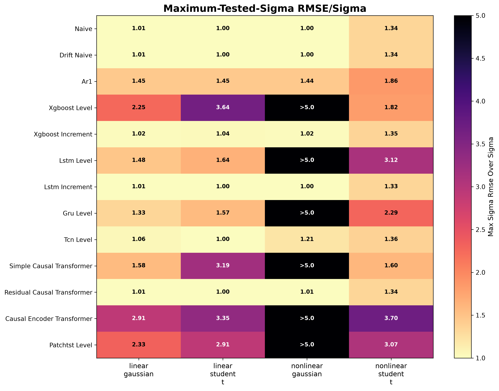
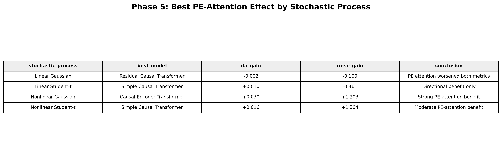

# Forecasting Collapse under Increasing Noise

**A Python research framework for studying the relationship between stochastic noise, forecast degradation, and the statistical complexity of predicted time series.**

[](https://www.python.org/)
[](https://pytorch.org/)
[](#forecasting-models)
[](#entropy-diagnostics)

This repository builds controlled synthetic time series with progressively increasing noise, compares classical and neural forecasting models, and diagnoses their performance using noise-normalized errors and entropy-based measures.

The work also investigates three ways to incorporate **permutation entropy (PE)** into causal Transformer models: as an additional input feature, through a differentiable training penalty, and as a bias in attention scores. A related TCN experiment tests whether PE features are useful beyond attention-based models.

**Research and implementation:** [Ali Khabazian](https://github.com/Alikhabazian0).

## Contents

- [Research objectives](#research-objectives)
- [Synthetic data generation](#synthetic-data-generation)
- [Forecasting protocol](#forecasting-protocol)
- [Forecasting models](#forecasting-models)
- [Evaluation and collapse criterion](#evaluation-and-collapse-criterion)
- [Entropy diagnostics](#entropy-diagnostics)
- [Permutation-entropy experiments](#permutation-entropy-experiments)
- [Figures and statistical comparisons](#figures-and-statistical-comparisons)
- [Repository map](#repository-map)
- [Installation and quick start](#installation-and-quick-start)
- [Running the research workflow](#running-the-research-workflow)
- [Interpretation and reproducibility](#interpretation-and-reproducibility)
- [References](#references)

## Research objectives

The experiments address four connected questions:

1. How does forecast error change as stochastic forcing increases in a time series with a known deterministic component?
2. How do model architecture and the choice of level or increment targets affect robustness to the changing noise regime?
3. How closely do the Shannon and permutation entropies of predictions match those of the target trajectory before an operational collapse boundary?
4. Can permutation entropy improve prediction when incorporated into input features, training objectives, or attention?

The framework combines **controlled simulation**, **comparative forecasting**, **complexity diagnostics**, and **entropy-based model interventions**. The collapse boundary is defined by an explicit error rule, making its meaning and resolution inspectable.

## Synthetic data generation

### Discrete stochastic update

The implemented Euler-Maruyama-style update is:

$$
x_t=x_{t-1}+a_t\Delta t
+\sigma_t\sqrt{\Delta t}\,\xi_t,
\qquad x_0=0.
$$

Here $a_t$ is the deterministic increment/drift supplied by the selected trend function, $\sigma_t$ is the scheduled noise amplitude, and $\xi_t$ is a standardized innovation. The implementation accumulates deterministic and stochastic increments; the executable update is authoritative where comments use different notation.

### Deterministic components

The linear case supplies a constant drift:

$$
a_t=\mu.
$$

The nonlinear-labelled case constructs a deterministic level:

$$
g_t=\mu t+A\sin\left(\frac{2\pi t}{P}\right),
$$

and supplies its discrete increments to the simulator:

$$
a_t=g_t-g_{t-1}.
$$

Thus, this case contains a linear trend plus a sinusoidal component; it is not a state-dependent nonlinear drift. The default $\Delta t=1$ makes the supplied discrete increment directly comparable with the simulator's time step.

### Innovation distributions

- **Gaussian:** independent standard-normal innovations.
- **Student-t:** innovations with three degrees of freedom, divided by $\sqrt{\nu/(\nu-2)}$ for $\nu>2$ to give unit population variance.

The Student-t case retains heavy tails after variance standardization. Finite samples can have substantially different realized variances, so the configured $\sigma_t$ is an innovation amplitude rather than a guarantee of the observed sample standard deviation.

### Four benchmark trajectories

| Generated file | Deterministic component | Innovations |
|---|---|---|
| `linear_gaussian.csv` | Constant drift | Gaussian |
| `linear_student_t.csv` | Constant drift | Student-t |
| `nonlinear_gaussian.csv` | Linear plus sinusoidal level | Gaussian |
| `nonlinear_student_t.csv` | Linear plus sinusoidal level | Student-t |

Each trajectory contains a stepwise increasing noise schedule. With the default configuration, 5,000 observations are divided into ten blocks with:

$$
\sigma\in\mathrm{linspace}(0,2,10).
$$

The generator saves `t`, `x`, `trend`, `noise`, `sigma`, `trend_type`, and `noise_type`, together with a combined `all_series.csv` file. The default seeds for the four combinations are 42, 43, 44, and 45.

### Core configuration

| Parameter | Default |
|---|---|
| Series length | `5000` |
| Time step | `1.0` |
| Noise levels | Ten values from `0.0` to `2.0` |
| Linear/nonlinear drift | `0.01` |
| Sinusoidal amplitude / period | `0.5` / `500` |
| Student-t degrees of freedom | `3` |
| Forecast horizon | `1` |
| Main look-back window | `16` |
| Alternative configured window | `8` |
| Base random seed | `42` |
| Collapse threshold | `1.0` |

Settings are defined in [`config/config.py`](config/config.py). Experiment scripts can also specify their own model and entropy parameters.

## Forecasting protocol

Supervised windows map the recent history to a future level:

$$
[x_{t-L+1},\ldots,x_t]\longrightarrow x_{t+h},
$$

with $L=16$ and $h=1$ by default. The windowing functions preserve chronological order.

The full benchmark uses a **70% training / 30% test split of supervised windows**. Predictions are aligned with their original target indices and noise labels. The full runner saves both test predictions and training-plus-test prediction tables for subsequent entropy analysis; training predictions are in-sample outputs.

The PE Transformer runners reserve the final 20% of their training partition for validation, yielding approximately **56% fitting / 14% validation / 30% test** of the supervised windows. These scripts and the main benchmark have separate configurations.

Because noise increases over time, the chronological test set emphasizes later, higher-noise regimes. Reported test metrics therefore cover the noise levels represented in the test partition, rather than an independent test sample at every configured noise level.

## Forecasting models

The full benchmark runner defines 13 model variants:

| Group | Variant | Prediction approach |
|---|---|---|
| Reference | Naive persistence | Predict the last observed level. |
| Reference | Drift naive | Add the mean training increment to the last level. |
| Classical | AR(1), through `ARIMAModel(order=(1, 0, 0))` | Refit the ARIMA wrapper during sequential prediction. |
| Trees | XGBoost level | Learn the future level from lagged observations. |
| Trees | XGBoost increment | Learn an increment and reconstruct the level. |
| Recurrent | LSTM level | Predict the future level. |
| Recurrent | LSTM increment | Predict an increment. |
| Recurrent | GRU level | Predict the future level. |
| Convolutional | TCN level | Use dilated temporal convolutions. |
| Attention | Simple causal Transformer | Predict a future level from causally masked representations. |
| Attention | Residual causal Transformer | Predict an increment and add it to the latest level. |
| Attention | Causal encoder Transformer | Use a deeper configuration of the causal level model. |
| Attention | PatchTST-style level model | Encode patches of the historical input window. |

Level and increment formulations provide an important comparison when levels drift beyond the training range. Their outputs are evaluated on the same final level scale.

### Full-benchmark neural settings

| Variant | Representative settings | Epochs |
|---|---|---|
| LSTM / GRU | Hidden width 32, one recurrent layer | 30 |
| TCN | Channels `(32, 32)`, kernel size 3, dropout 0.1 | 30 |
| Simple causal Transformer | Width 16, two heads, one layer, feed-forward width 32 | 100 |
| Residual causal Transformer | Width 32, four heads, one layer, feed-forward width 64 | 50 |
| Causal encoder Transformer | Width 32, four heads, three layers, feed-forward width 128 | 50 |
| PatchTST-style model | Patch length 4, stride 4, width 32, four heads, one layer | 50 |

These are settings in `run_all_models_all_series_full.py`, rather than universal class defaults. The PE experiment runners use their own configurations and should be compared using the saved run metadata.

## Evaluation and collapse criterion

### Noise-normalized forecast error

For each test noise level, the code calculates:

$$
\mathrm{RMSE}(\sigma)
=\sqrt{\frac{1}{N_\sigma}\sum_{i\in\mathcal{I}_\sigma}
(y_i-\widehat y_i)^2},
$$

$$
E(\sigma)=\frac{\mathrm{RMSE}(\sigma)}{\sigma}.
$$

At $\sigma=0$, the normalized error is recorded as `NaN`; it is not used in collapse detection. This normalization uses the configured noise amplitude and is distinct from normalization by the target's standard deviation or range.

Directional accuracy compares the signs of consecutive changes in the target and prediction arrays:

$$
\mathrm{DA}=\frac{1}{N-1}\sum_{i=2}^{N}
\mathbf{1}\left[
\mathrm{sgn}(y_i-y_{i-1})=
\mathrm{sgn}(\widehat y_i-\widehat y_{i-1})
\right].
$$

This is the implemented consecutive-change metric. It does not compare each forecast with the same last observed value, which would define a different directional metric.

### Operational collapse

After sorting valid noise levels, `find_collapse_point()` returns the first noise amplitude for which:

$$
E(\sigma_i)\ge c
\quad\text{and}\quad
E(\sigma_{i+1})\ge c,
$$

with default threshold $c=1$ and two required consecutive levels. If no qualifying pair exists, it returns `None`.

The result is an **operational noise-normalized error boundary**. Its location depends on the noise grid, threshold, prediction protocol, and finite-sample errors. A value close to one can also reflect the innovation-error scale of a well-modelled stochastic process; the rule alone does not establish an information-theoretic impossibility of prediction.

The reporting code distinguishes performance at the detected boundary, mean error before the boundary, and error at the maximum tested noise level. These answer different questions and should retain their original labels.

## Entropy diagnostics

### Shannon entropy

The entropy helper forms a histogram and computes:

$$
H=-\sum_b p_b\log_2 p_b,
\qquad
H_{\mathrm{norm}}=\frac{H}{\log_2 B},
$$

where $B=30$ by default. The entropy is in bits before normalization. Histogram edges are determined separately for each input array by `np.histogram`; they are not fixed common edges shared across all trajectories or segments.

### Permutation entropy

For embedding order $m$ and delay $\tau$, the helper counts the ordinal patterns obtained from:

$$
(x_t,x_{t+\tau},\ldots,x_{t+(m-1)\tau}).
$$

It then computes:

$$
H_{\mathrm{PE}}=-\sum_\pi p(\pi)\log_2 p(\pi),
\qquad
H_{\mathrm{PE,norm}}=
\frac{H_{\mathrm{PE}}}{\log_2(m!)}.
$$

The basic diagnostic uses $m=3$ and $\tau=1$. Patterns are generated with `np.argsort`, so tied values follow that implementation's ordering convention. Short inputs can produce `NaN`.

### Prediction-versus-target complexity

Entropy analyses compare target and prediction complexity using absolute differences:

$$
\Delta H=|H_{\mathrm{true}}-H_{\mathrm{pred}}|,
\qquad
\Delta H_{\mathrm{PE}}=
|H_{\mathrm{PE,true}}-H_{\mathrm{PE,pred}}|.
$$

The repository includes analyses grouped by noise level, trajectories segmented up to a collapse-related endpoint, and analyses restricted to the test interval. The latter distinguish confirmed and unconfirmed collapse cases in their output metadata.

The shared segmentation helper maps the **first threshold crossing** to a test index, whereas the main collapse detector requires **two consecutive crossings**. These endpoint definitions can differ. The test-only script checks confirmation separately, so endpoint labels and collapse flags should be inspected together.

## Permutation-entropy experiments

### 1. Parameter calibration and rolling features

The parameter search evaluates:

```python
WINDOW_GRID = [8, 12, 16]
ORDER_GRID = [3, 4, 5]
DELAY_GRID = [1, 2]
```

Each rolling PE feature uses the current and preceding values in its selected window. Parameter combinations are scored by the separation between low- and high-noise groups:

$$
S=\frac{|\overline{\mathrm{PE}}_{\mathrm{high}}
-\overline{\mathrm{PE}}_{\mathrm{low}}|}
{s_{\mathrm{low}}+s_{\mathrm{high}}+\varepsilon},
$$

where groups are defined using the lower and upper noise quartiles. The highest-scoring settings are selected separately for each process.

The current parameter optimization uses the full generated trajectory and its known noise labels. This is an exploratory noise-separation calibration. An untouched out-of-sample evaluation would require fitting that selection only within a training/calibration partition.

### 2. PE as an input feature

The feature experiment compares:

```python
sigma_feature = ["x", "sigma"]
sigma_pe_feature = ["x", "sigma", "pe_feature"]
```

Three causal Transformer configurations and a separate TCN pipeline evaluate these feature sets. Here `sigma` is supplied by the simulator, so these are experiments with a known noise-state feature. Applying the method to an observed series requires specifying how that information is obtained.

### 3. PE-inspired training objective

The loss experiment combines MSE with a differentiable ordinal-complexity mismatch:

$$
\mathcal{L}=\mathcal{L}_{\mathrm{MSE}}
+\lambda_{\mathrm{PE}}\mathcal{L}_{\mathrm{soft\ ordinal}},
\qquad \lambda_{\mathrm{PE}}\in\{0,0.05\}.
$$

The surrogate forms pairwise ordering probabilities using a sigmoid, averages them, and compares binary-entropy summaries for targets and predictions. It uses local windows across the ordered batch, natural logarithms, order 5, and temperature 0.1. The training loader sets `shuffle=False`.

**This loss is a differentiable PE-inspired surrogate, not the exact histogram of permutation patterns used by the diagnostic PE function.** The target summary is detached while the prediction summary remains differentiable.

### 4. PE-biased causal attention

The attention experiment modifies each query-key score as:

$$
s_{ij}=\frac{Q_iK_j^{\mathsf T}}{\sqrt{d_h}}
-\gamma\,\mathrm{PE}_j,
\qquad \gamma=0.1,
$$

before applying the causal mask and softmax. The bias acts on the **key position**, reducing its score when its supplied PE is larger. The runner compares standard attention and PE-biased attention within each selected model configuration.

## Figures and statistical comparisons

### Maximum-tested-noise benchmark



The committed heatmap compares the 13 variants across the four processes at their maximum tested noise levels. Persistence, drift, and several increment/residual approaches show errors close to the configured innovation scale in multiple cases. Several level-prediction models have larger errors in the displayed runs. These are stored experiment results, not a universal model ranking.

### PE-attention experiment summary



The committed summary shows that the effect of PE attention varies across processes: the displayed linear Gaussian case worsens, the linear Student-t case has a directional benefit only, and the nonlinear-labelled cases show benefits under the stored comparison. The intervention is therefore evaluated experimentally rather than assumed to improve every process.

The statistical-significance notebook compares model ranks over the four process categories using a Friedman test, an approximate Nemenyi-style critical-difference calculation, and paired Wilcoxon comparisons. Its critical-value constant is hard-coded, so the calculation must be revisited if the model set changes. Four process cases provide a limited basis for inferential conclusions; repeated independent simulations are needed to assess robustness across realizations.

## Repository map

| Location | Role |
|---|---|
| [`config/config.py`](config/config.py) | Simulation and core forecasting settings. |
| [`src/generation/`](src/generation/) | Deterministic components, innovation distributions, and trajectory generation. |
| [`src/features/windowing.py`](src/features/windowing.py) | Supervised windows and chronological splitting. |
| [`src/models/`](src/models/) | Reference models, ARIMA/XGBoost, recurrent/convolutional models, and Transformer variants. |
| [`src/evaluation/`](src/evaluation/) | Error metrics, collapse detection, and entropy calculations. |
| [`src/experiments/`](src/experiments/) | Benchmark runners, entropy analyses, and PE intervention workflows. |
| [`src/utils/segmentation.py`](src/utils/segmentation.py) | Time alignment and collapse-related segmentation. |
| [`src/visualization/`](src/visualization/) | Benchmark, entropy, ranking, and intervention figures. |
| [`notebooks/`](notebooks/) | Interactive checks, figure refinement, entropy analysis, and statistical comparisons. |
| [`figures/`](figures/) | Committed plots from the research runs. |
| [`data/`](data/) / [`results/`](results/) | Locations populated by generators and experiment scripts. |

The inspected public tree contains placeholder files in `data/` and `results/`; the generated datasets and run-result CSVs must be recreated to execute downstream analyses. Committed figures preserve snapshots of earlier runs.

## Installation and quick start

### Install dependencies

```bash
git clone https://github.com/Alikhabazian0/Noise-Collapse-Diagnosis.git forecast-collapse
cd forecast-collapse
python -m pip install numpy pandas scipy scikit-learn statsmodels xgboost torch matplotlib jupyterlab
```

Use the [official PyTorch installation selector](https://pytorch.org/get-started/locally/) if a platform-specific CUDA build is required. Run commands from the repository root.

### Generate the synthetic data

```bash
python -m src.generation.generate_all_series
```

This creates the four process CSVs and their combined file under `data/generated/`.

### Run a lightweight persistence example

```python
from src.models.naive import NaivePersistence
from src.experiments.run_single_model_full import run_single_model_full

evaluation, test_predictions, full_predictions, collapse_sigma = (
    run_single_model_full(
        model=NaivePersistence(),
        model_name="naive",
        file_path="data/generated/linear_gaussian.csv",
        results_dir="results/quickstart",
    )
)

print(evaluation[["sigma", "rmse", "rmse_over_sigma", "directional_accuracy"]])
print("Operational collapse sigma:", collapse_sigma)
```

This exercises the generator, supervised windows, prediction alignment, grouped metrics, collapse rule, and result-file export without neural training.

## Running the research workflow

### Benchmark and entropy analysis

```bash
python -m src.experiments.run_all_models_all_series_full
python -m src.experiments.run_precollapse_entropy
python -m src.experiments.run_test_only_entropy
```

The full benchmark writes to `results/2026-06-25_full_benchmark_with_train_predictions/`, which is also the default source used by the two entropy commands above. It produces test metrics, test predictions, aligned full predictions, and corrected summaries.

AR(1) refitting and multiple neural-model runs can make the complete benchmark computationally expensive. Begin with the persistence example or a reduced model list in `build_models()` before launching the full set.

### PE interventions

Run the feature-preparation steps first:

```bash
python -m src.experiments.optimize_pe_parameters
python -m src.experiments.generate_pe_features
```

Then choose the relevant comparisons:

```bash
python -m src.experiments.run_pe_feature_transformer_experiments
python -m src.experiments.run_pe_loss_transformer_experiments
python -m src.experiments.run_pe_attention_transformer_experiments
python -m src.experiments.run_tcn_pe_feature_experiments
```

These write metrics, predictions, summaries, and, where implemented, training histories under `results/pe_transformer_experiment/`.

### Plotting and notebook analyses

```bash
jupyter lab
```

Choose the relevant notebook or visualization script after its source CSVs exist. Some older plotting scripts, the noise-level entropy runner, and the significance notebook still point to `results/2026-06-25_full_benchmark/`, rather than the full-prediction benchmark directory. Align their `RESULTS_DIR` and summary-file settings with the run being analyzed before execution.

## Interpretation and reproducibility

Several design choices are central to interpreting the research:

- **Changing noise and time:** the increasing noise schedule is coupled to chronology. Error changes can reflect both the noise regime and extrapolation beyond the training level range.
- **Operational collapse:** the two-level rule is a project-defined performance boundary. It should be reported with the threshold and available test-noise grid.
- **Endpoint definitions:** segmentation uses a first crossing, while confirmation uses consecutive crossings; preserve both definitions when comparing outputs.
- **Known noise features:** PE feature, loss, and attention experiments supply the simulator's `sigma` as an input. This differs from a model supplied only with observed levels.
- **PE calibration:** full-trajectory parameter selection uses information from the later evaluation regime. A stricter predictive study would fit that selection within training data.
- **Entropy comparability:** histogram edges are array-specific; ordinal tie handling and short-window sample sizes also affect entropy estimates.
- **AR(1) history:** the wrapper refits from stored training history and appends the last value of each supplied window. Audit temporal alignment when reproducing its train/test comparisons, especially for the exported training predictions.
- **Statistical scope:** model rankings are based on four process categories in the stored comparisons, rather than a large collection of independent Monte Carlo replications.
- **Experiment versions:** main-benchmark and PE-run model settings differ. Compare variants within the intended run family and retain the corresponding metadata.

For reproducibility, save the Git commit, dependency versions, generator parameters and seeds, split indices, model settings, PE calibration parameters, collapse rule, raw predictions, grouped metrics, and figure-source tables. Report both forecast accuracy and complexity diagnostics: matching entropy alone does not imply accurate point forecasts.

## References

The experiment framework, comparisons, and PE interventions are implemented by **Ali Khabazian**. The following references provide the methodological foundations; they are not claims that every model here reproduces an authors' official implementation.

1. **Shannon, C. E. (1948).** A mathematical theory of communication. *The Bell System Technical Journal, 27*(3), 379-423. [DOI](https://doi.org/10.1002/j.1538-7305.1948.tb01338.x).
2. **Bandt, C., & Pompe, B. (2002).** Permutation entropy: A natural complexity measure for time series. *Physical Review Letters, 88*, 174102. [DOI](https://doi.org/10.1103/PhysRevLett.88.174102).
3. **Vaswani, A., et al. (2017).** Attention Is All You Need. *Advances in Neural Information Processing Systems, 30*. [Paper](https://arxiv.org/abs/1706.03762).
4. **Nie, Y., Nguyen, N. H., Sinthong, P., & Kalagnanam, J. (2023).** A Time Series is Worth 64 Words: Long-term Forecasting with Transformers. *International Conference on Learning Representations*. [Paper](https://arxiv.org/abs/2211.14730).

When using this repository in research, acknowledge the implementation and specify the commit and experiment configuration used. Cite the relevant foundational papers for the methods incorporated into your analysis.
